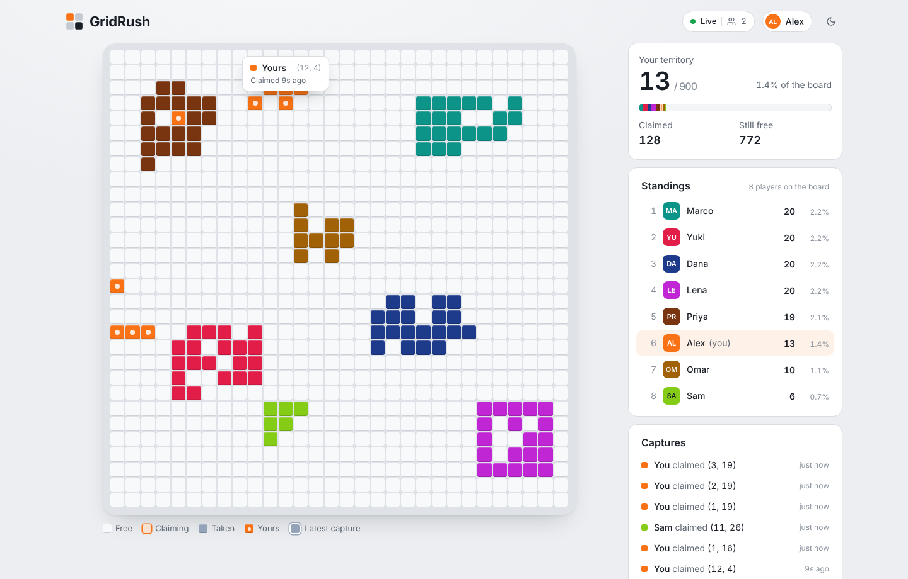

# GridRush

A shared 30 × 30 board where everyone races to claim cells. Click a free cell and it becomes yours; every other player sees it change color within a fraction of a second. Two people clicking the same cell at the same moment can never both win.



- **Frontend:** React 19, TypeScript, Vite, Tailwind CSS v4, shadcn-style components (Radix), Lucide icons, Zustand
- **Backend:** Node.js, Express, TypeScript, Socket.IO, MongoDB + Mongoose, Zod
- **Deploy:** Vercel (client), Render (API), MongoDB Atlas (database)

```
gridrush/
├── shared/   Types, Zod schemas, constants and Socket.IO event names used by both sides
├── server/   Express + Socket.IO API, Mongoose models, services, tests
└── client/   React app
```

---

## Quick start (local)

You need **Node 20+** and a MongoDB you can reach (local `mongod`, Docker, or a free Atlas cluster).

```bash
# 1. Install everything (npm workspaces)
npm install

# 2. Configure
cp server/.env.example server/.env      # set MONGODB_URI
cp client/.env.example client/.env      # defaults to http://localhost:4000

# 3. Run API + client together
npm run dev
```

Open http://localhost:5173, pick a name, and claim a cell. Open a second browser (or a private window) to play against yourself and watch updates arrive live.

No MongoDB installed? The quickest local option is Docker:

```bash
docker run -d --name gridrush-mongo -p 27017:27017 mongo:7
```

The first API start creates the 900 cell documents automatically. It is safe to restart at any time — existing ownership is never touched.

### Useful scripts

| Command | What it does |
| --- | --- |
| `npm run dev` | API on :4000 (auto-reload) and client on :5173 |
| `npm test` | Backend test suite (starts its own in-memory MongoDB) |
| `npm run typecheck` | Type-check all three packages |
| `npm run build` | Production build of shared, server and client |
| `npm run board:reset -w server` | Clear every cell's owner (players are kept) |

---

## How claiming works (the important part)

A claim is **one** database operation:

```ts
Cell.findOneAndUpdate(
  { cellId, ownerId: null },                                   // only if nobody owns it
  { $set: { ownerId, claimedAt: now }, $inc: { version: 1 } },
  { new: true },
);
```

MongoDB applies a single-document update atomically. When two requests race for the same free cell, the first one to reach the document sets `ownerId`; the second one's filter (`ownerId: null`) no longer matches, so it changes nothing and gets `null` back. There is no "read, check, then write" gap for a race to slip through.

After that:

- **Got a document back** → the claim is saved. The API responds `201` and *only then* broadcasts `cell:claimed` to everyone.
- **Got nothing back** → the server reads the cell only to explain the result:
  - you already own it → `200 { alreadyOwned: true }` (a double-click or retry is harmless, nothing is re-broadcast);
  - someone else owns it → `409 CELL_TAKEN` with the real owner, so your board corrects itself immediately;
  - the cell doesn't exist → `404`.

A unique index on `cellId` guarantees one document per cell, so initialization can run from several processes at once without creating duplicates.

### Keeping every screen in sync

Each cell has a `version` that goes up by one on every change. Clients ignore any update whose version isn't newer than what they have, which makes duplicate and out-of-order events harmless.

On every connect *and* reconnect the client:

1. sends `board:subscribe`;
2. buffers live `cell:claimed` events while it waits;
3. receives `board:snapshot` (all claimed cells, their owners, recent activity) and replaces its local state;
4. re-applies the buffered events — only the ones newer than the snapshot land.

The server joins the socket to the board room *before* reading the snapshot, so nothing can fall between the two. Anything missed while offline comes back with the fresh snapshot. If the socket can't connect at all, the client refreshes the board over HTTP every 10 seconds until it can.

---

## API

All errors use one shape: `{ "error": { "code": "CELL_TAKEN", "message": "…", "details": … } }`.

| Method & path | Auth | Description |
| --- | --- | --- |
| `GET /api/health` | – | `200` when the database is connected, `503` otherwise |
| `POST /api/session` | – | Body `{ displayName }` → `201 { user, token }`. Creates an anonymous player with a random color. |
| `GET /api/session` | Bearer | `200 { user }` for a stored token, `401` if unknown |
| `GET /api/board` | – | Full snapshot (same shape as `board:snapshot`) |
| `GET /api/leaderboard?limit=10&offset=0` | – | Ranked players, computed with a MongoDB aggregation |
| `POST /api/cells/:cellId/claim` | Bearer | `201` claimed, `200` already yours, `409` taken, `400` bad id, `401` no session, `429` too fast |

`cellId` is 0–899, row-major (`row * 30 + col`). The UI shows 1-based `(x, y)` coordinates.

### Socket.IO events

The socket handshake must include `auth: { token }`.

| Event | Direction | Payload |
| --- | --- | --- |
| `board:subscribe` | client → server | – (throttled to once per second per socket) |
| `board:snapshot` | server → client | `{ gridSize, cells, owners, activity, serverTime }` |
| `cell:claimed` | server → all | `{ cellId, ownerId, owner, claimedAt, version }` — sent only after the database confirms |
| `user:presence` | server → all | `{ online }` — unique players connected right now |
| `board:error` | server → client | `{ code, message }` |

### Data model

**User** — `displayName`, `color`, `tokenHash` (SHA-256 of the session token; the raw token never touches the database), `createdAt`, `lastSeenAt`.

**Cell** — `cellId` (unique index), `ownerId` (nullable, indexed), `claimedAt` (nullable, indexed), `version`.

---

## Testing

```bash
npm test
```

The suite boots the real Express + Socket.IO server on a random port against a throwaway database. By default it downloads and starts a real `mongod` through `mongodb-memory-server` (first run takes a minute). To use a MongoDB you already have instead:

```bash
MONGO_TEST_URL=mongodb://127.0.0.1:27017 npm test   # each test file uses its own temporary database
```

What's covered (31 tests in `server/test/`):

| Requirement | Test |
| --- | --- |
| Claim an unclaimed cell | `claims.test.ts` › lets a user claim an unclaimed cell |
| Claim is persisted (and survives a reconnect) | `claims.test.ts` › persists the claim / keeps ownership across a database reconnect |
| Can't claim an owned cell | `claims.test.ts` › rejects claiming a cell someone else owns |
| Two concurrent claims → exactly one winner | `claims.test.ts` › 25 users over HTTP; 10 rounds × 10 users at the service layer; one user spamming the same cell |
| Different users, different cells, concurrently | `claims.test.ts` › lets different users claim different cells at the same time |
| Broadcast on success (and only on success) | `realtime.test.ts` › broadcasts…; does not broadcast failed or repeated claims; exactly one event per race |
| New client gets current state | `realtime.test.ts` › gives a newly connected client the current board |
| Reconnecting client recovers | `realtime.test.ts` › recover missed claims on reconnect; no duplicate events after resubscribing |
| Invalid input rejected | `claims.test.ts` › invalid cell ids, unexpected body, bad/missing token, malformed JSON, oversized payload |
| Leaderboard matches the database | `leaderboard.test.ts` › compares every count against the `cells` collection; pagination; bad params |
| Idempotent initialization | `board.test.ts` › three concurrent `ensureBoard()` calls, ownership preserved, unique index enforced |

---

## Deployment

### 1. Database — MongoDB Atlas

1. Create a free cluster at cloud.mongodb.com.
2. **Database Access** → add a user with read/write access.
3. **Network Access** → allow `0.0.0.0/0` (Render's free tier has no fixed outbound IP).
4. **Connect → Drivers** → copy the `mongodb+srv://…` string and add `/gridrush` before the `?`.

### 2. API — Render

1. Push this repo to GitHub.
2. In Render: **New → Blueprint**, pick the repo. It reads `render.yaml`.
3. Fill in the two secret variables when prompted:
   - `MONGODB_URI` — your Atlas string
   - `CLIENT_ORIGIN` — your Vercel URL, e.g. `https://gridrush.vercel.app` (comma-separate several)
4. Deploy, then check `https://<your-service>.onrender.com/api/health` returns `{"ok":true}`.

(Without the blueprint: Web Service, build `npm ci --include=dev && npm run build -w shared && npm run build -w server`, start `npm run start -w server`, health check `/api/health`, and set `NODE_ENV=production`, `TRUST_PROXY=1` plus the two variables above.)

### 3. Client — Vercel

1. **Add New → Project**, import the repo, keep **Root Directory** at the repo root. `vercel.json` sets the install/build commands and the `client/dist` output.
2. Add the environment variable `VITE_API_URL=https://<your-service>.onrender.com`.
3. Deploy. If the Vercel URL differs from what you put in `CLIENT_ORIGIN`, update it on Render.

---

## Design decisions and trade-offs

- **One conditional update instead of transactions or locks.** Ownership lives on a single document, so MongoDB's single-document atomicity is all the concurrency control needed. No transactions, no replica set requirement, no Redis lock.
- **REST for claims, Socket.IO for broadcasts.** Claims get clear status codes, standard rate limiting and easy testing; the socket only pushes facts the database has already confirmed.
- **No optimistic ownership in the UI.** A clicked tile shows a pulsing "claiming" state in your color and only fills in when the server confirms. For a contested resource this is more honest than optimistic UI and needs no rollback logic. Locally a claim round-trip is well under 300 ms, so it still feels immediate.
- **Snapshots instead of event replay on reconnect.** The whole board is at most 900 small entries (only claimed cells are sent), so a fresh snapshot is cheaper and simpler than tracking per-client missed events.
- **Live standings are computed in the browser** from the board the client already holds (itself a mirror of the database), so a claim costs one small event, not a leaderboard refetch. `GET /api/leaderboard` computes the same ranking with a MongoDB aggregation for other uses, and a test checks both agree with the raw data. Ties go to the player who joined first.
- **Anonymous sessions with opaque tokens.** A random 256-bit token is stored in `localStorage`; the database keeps only its SHA-256 hash. Simple, revocable and nothing to leak from the database. JWTs would add little here.
- **Rendering 900 cells efficiently.** Each tile subscribes to its own slice of the store and is memoized, so one claim re-renders one tile. Hover, click and keyboard handling are delegated to the grid element, and a single shared tooltip is positioned from row/column percentages — no per-tile listeners or tooltip instances.
- **Your color is the interface accent.** Focus rings, the pending state, your standings row and the logo tile all use the color you were assigned, so the board always reads from your side.

### Single-server assumption

Presence counts and Socket.IO rooms live in one Node process. That's right for one Render instance. To run several instances:

1. add `@socket.io/redis-adapter` so a broadcast from any instance reaches clients on all of them;
2. move presence into Redis (a set per user with expiring socket entries);
3. enable sticky sessions (or force the websocket transport) on the load balancer;
4. move rate-limit counters to Redis (`rate-limit-redis`).

Claim correctness needs no change — it already lives entirely in MongoDB.

---

## Known limitations

- **Claims are permanent.** There's no stealing, decay or unclaiming; once all 900 cells are taken, the board is full until someone runs `npm run board:reset -w server`. Open tabs pick up a reset on their next reconnect (restarting the API forces that).
- **Identity is per browser.** Clearing site data or switching devices creates a new player; there's no account recovery or name change.
- **Render free tier sleeps** after inactivity. The first request after a nap can take ~30–60 s; the client shows "Connecting…" and keeps retrying.
- **Rate limits are in memory** and reset when the API restarts (fine for one instance; see scaling notes).
- **Small screens:** at phone width each cell is ~11 px. It's playable, but there's no pinch-zoom on the board itself.
- **No moderation** of display names beyond length and allowed characters.
- **Colors repeat** after 14 players (each new player gets one of the least-used colors), so at large player counts two people can share a hue. Your own cells always carry a white notch.
